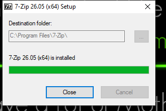
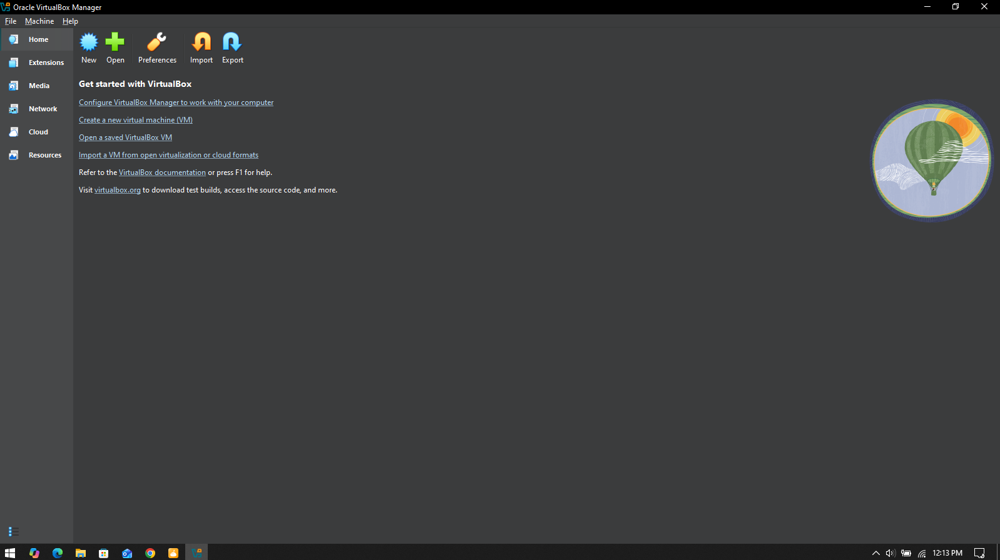
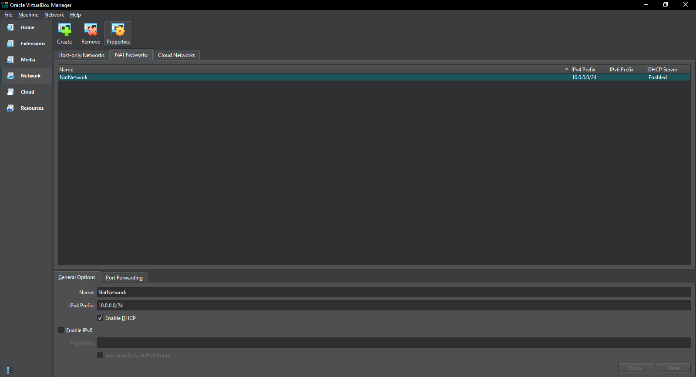
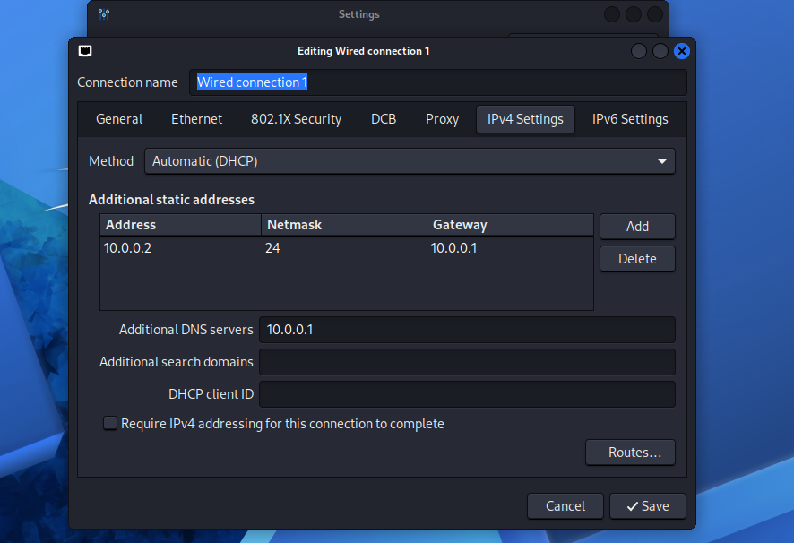
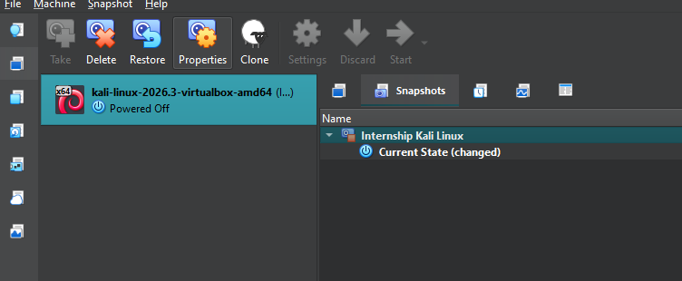

# Networkwalks-B084N-week1-Cybersecurity-Lab-Setup
Cybersecurity Lab Setup

## Project Overview
For Week 1 of the Cyber Securtiy Internship held by **Networkwalks** I have setup a virtual lab on Kali Linux via Oracle Virtual Box. 
Installed Zip File, Downloaded Kali Linux and configured Network as per the requirements 

## Objectives of Lab
- Install Oracle VirtualBox on my laptop.
- Installed Latest version of  Kali Linux.
- Import Kali Linux zip file on the virtual machine.
- Configure private NAT Network for the cybersecurity lab.
- Configure and verify network connectivity for Kali Linux.
- Create a snapshot for current clean setup/state on the VM.
- Create a configured and protected lab environment for practice.

## The Purpose of the Lab 
The lab provides a controlled environment for cybersecurity learning and authorized security testing in this internship program.

The Following Activities will be performed
- Network reconnaissance
- Port scanning
- Vulnerability assessment
- Packet analysis
- Web security testing
- Exploitation practice
- Security-tool experimentation

# Lab Setup Procedure
### Step-1: Install 7-Zip Software
7-Zip was installed to extract the Kali Linux virtual-machine package, which may be distributed as a .7z archive.

**Tool**: 7-Zip



### Step 2: Install Oracle VirtualBox 
Oracle Virtual Box Manager was installed on my Computer

**Tool**: Virtual Box Manager

 

### Step 3: Creating NAT Network 
Configured Network Name as NatNetwork, IPv4 Prefix as 10.0.0.0/24 and DHCP as Enabled



A NAT Network was chosen to enable communication between lab VMs while providing outbound internet connectivity for future attacker and target machines.

### Step 4: Import Kali Linux in VM

The Kali Linux Virtual Machine with 7-Zip File was downloaded from the official Kali Linux website and imported into VirtualBox.
The VM network adapter was configured as follows:

```bash
Adapter 1
Attached to: NAT Network
Network:     NatNetwork
Adapter Type: Intel PRO/1000 MT Desktop
RAM: 4046 MB
```


### Step 5: Configure the Network in Linux

The Kali Linux network configuration was configured with a IPv4 address.

The Example as Follows
```bash
IP Address: 10.0.0.2
Subnet Mask: 255.255.255.0
Gateway: 10.0.0.1
DNS: 8.8.8.8
```



### Step 6: Create a Clean Snapshot

After completing the initial configuration, a VirtualBox snapshot was created.

The Snapshot Name is 
```bash
Internship Kali Linux
```



# Lab Verification 

| **Test** | **Command** | **Results** |
|---|---|---|
| Check IP address | `ip a` | Correct Kali IP displayed |
|  Test gateway | `ping 10.0.0.1` | Successful replies |
| Test Internet connectivity	 | `ping 8.8.8.8` | Successful replies |
| Verify snapshot | Restore snapshot and run `ip a` | Baseline configuration restored |

# Problems Encountered & Solutions

## Problem-1: No Internet Connection on VirtualBox.
The Kali Linux VM was unable to connect to the internet due to incorrect VirtualBox network settings.

## Solution 

- Checked the VirtualBox network settings.
- Selected the correct network adapter and NAT Network.
- Restarted the VM and verified internet connectivity.

# Security and Ethical Use
This laboratory is intended strictly for education purposes only.

# Tools & resources
- 7-Zip: https://7-zip.org/download.html
- VirtualBox: https://virtualbox.org/wiki/Downloads
- Kali Linux: https://kali.org/get-kali

# Author
**Safar Khan** Networkwalks Internee Batch B084N

Linkedin: https://www.linkedin.com/in/saffarkhan/


  
  
  
